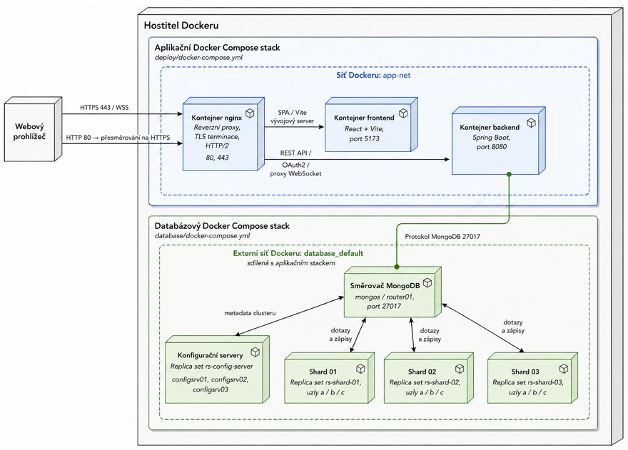
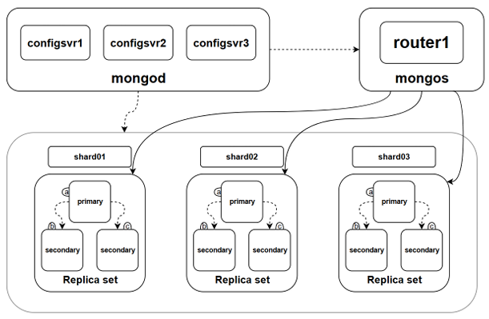
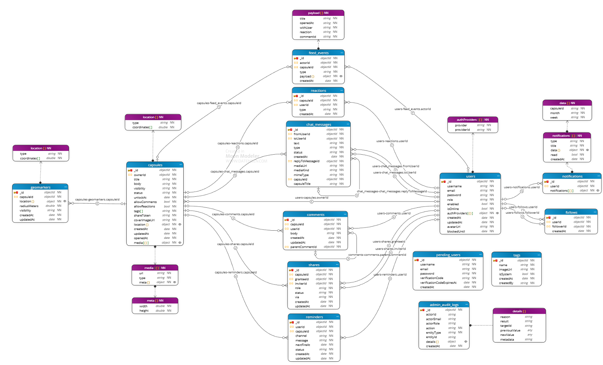
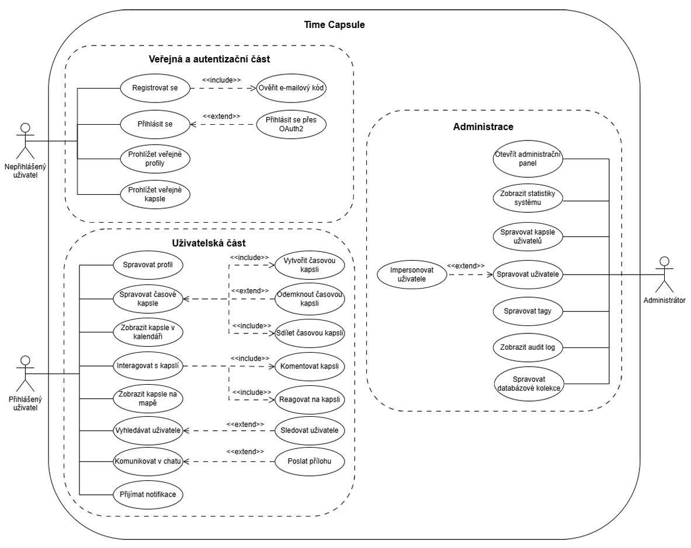
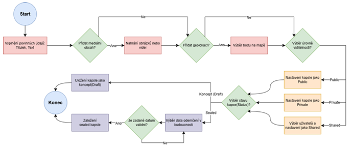
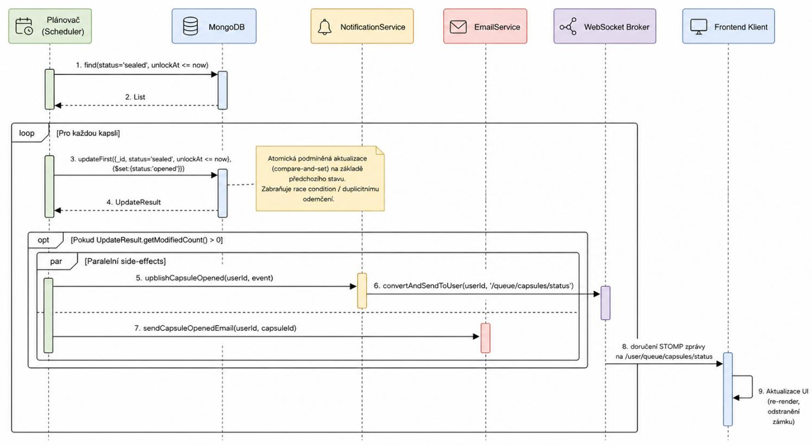
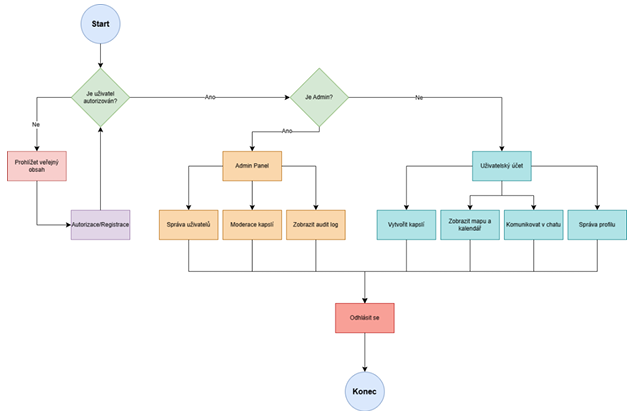

# Time Capsule

<p align="center">
  <a href="README.md"></a>
  <a href="README.cs.md"></a>
  <a href="README.ua.md"></a>
  <a href="README.ru.md"></a>
</p>

<p align="center">
  
  
  
  
  
  
</p>

Time Capsule — это веб-платформа для создания, хранения и открытия капсул времени. Пользователи могут оставлять сообщения, файлы, фото, видео, геометки, комментарии и активность, которые становятся доступны только после наступления заданной даты или выполнения условий разблокировки.

Проект объединяет Spring Boot backend, React/Vite frontend, шардированный MongoDB и Docker Compose для локального запуска и развертывания.

---

## 📖 Обзор проекта

Основная идея проекта — дать пользователю возможность оставлять сообщения для будущего. Условия открытия капсулы могут зависеть от времени, авторизации, наличия контента или других правил.

Этот проект демонстрирует не только социальную платформу, но и полный жизненный цикл работы с:

- авторизацией и профилями
- CRUD для капсул
- медиа-контентом
- картами и геометками
- чатом и активностью
- администрированием и аудитом
- архитектурой MongoDB с шардированным хранением

---

## ✨ Основные возможности

- Создание, редактирование и удаление капсул времени
- Просмотр капсул в разных режимах: календарь, карта, список и профиль
- Публичные и приватные капсулы
- Управление доступом по условиям открытия
- Хранение медиа: изображения, видео, файлы
- Комментарии, реакции, подписки и лента активности
- Чат с другими пользователями
- Админ-панель для управления пользователями и данными
- OAuth-вход через Google/GitHub
- Автоматический запуск через Docker Compose

---

## 🛠️ Технологический стек

### Frontend
- React
- TypeScript
- Vite
- React Router
- Tailwind CSS
- Leaflet / Cesium
- STOMP / SockJS

### Backend
- Java 17
- Spring Boot 3.5
- Spring Web
- Spring Security
- Spring Data MongoDB
- Validation
- Actuator

### Data layer
- MongoDB sharded cluster
- Replica sets
- Config servers
- `mongos` router

### Infrastructure
- Docker Compose
- Nginx reverse proxy
- HTTPS termination for local development

---

## 🏗️ Архитектура системы

Приложение следует многоуровневой архитектуре: публичная точка входа, клиентский интерфейс, backend API и шардированное хранилище MongoDB.

| Уровень | Описание | Основные компоненты |
| --- | --- | --- |
| Edge layer | Публичный доступ и завершение HTTPS | Nginx reverse proxy |
| Presentation layer | Интерфейс пользователя и навигация на клиенте | React + Vite frontend |
| Application layer | Бизнес-логика, авторизация, API и события в реальном времени | Spring Boot backend, OAuth, WebSocket |
| Data layer | Постоянное хранение и распределённая база данных | MongoDB router, config servers, shards |

<p align="center">
  
</p>

### Обзор архитектуры

- Приложение доступно через хост и проксируется через nginx.
- Фронтенд запущен в отдельном Docker-контейнере и обращается к backend API.
- Backend обрабатывает авторизацию, логику капсул, доступ к медиа, админ-операции и обновления в реальном времени.
- MongoDB развернут как шардированный кластер с config-серверами и replica sets для отказоустойчивости.
- В системе также присутствуют OAuth, уведомления и чатовые потоки.

### Основные домены системы

- Пользователи и профили
- Капсулы времени
- Медиа и вложения
- Комментарии, реакции и подписки
- Сообщения и чат
- Администрирование и аудит
- Геометки и активность на карте

---

## 🧭 Архитектура и документация проекта

В репозитории уже содержатся реальные диаграммы и артефакты архитектуры. Этот README использует именно эти материалы вместо выдуманных схем.

- [doc/dev playbook.md](doc/dev%20playbook.md) — локальная архитектура, Docker Compose, шардированный MongoDB и HTTPS.
- [frontend/README.md](frontend/README.md) — стек фронтенда, маршруты и переменные окружения.
- [backend/pom.xml](backend/pom.xml) — стек технологий backend и Java/Spring Boot.

### Схема развертывания системы


Эта диаграмма показывает хост-среду с веб-приложением, reverse proxy, frontend-контейнером, backend API и стеком MongoDB.

### Топология MongoDB-кластера



Эта диаграмма отражает конфигурацию replica sets, config-серверов и маршрутизатора `mongos`.

### Модель данных / доменная модель



Это основная доменная модель. Она показывает связи между пользователями, капсулами, комментариями, реакциями, уведомлениями, подписками, напоминаниями, тегами и аудитом администратора.

### Поток пользователя / жизненный цикл приложения



Этот flow показывает логику пользователя и администратора: регистрация, проверка доступа, управление панелью, профиль и операции с капсулами.

### Поток создания капсулы



Эта диаграмма соответствует процессу создания капсулы, проверке публичности/приватности и окончательной публикации.

### Sequence diagram автоматического открытия капсулы



Эта диаграмма показывает автоматический процесс, в котором планировщик проверяет статус капсулы, обновляет её состояние, запускает уведомления и отправляет обновления на frontend, когда капсула становится доступной.

### Обзор use case системы



Эта схема суммирует основные сценарии системы: планирование, уведомления, email-сервис, websocket-передачу и операции с капсулами.

### Резюме из документации

Репозиторий содержит Spring Boot backend, React/Vite frontend, nginx dev proxy и локальный shардированный MongoDB cluster. Стек запускается через Docker Compose, а база данных запускается раньше, потому что основной compose ожидает внешнюю Docker-сеть `database_default`.

Документация описывает:

- MongoDB `mongos` router на порту `27017`
- три config-сервера
- три shard replica sets
- инициализацию схем и импорт seed-данных
- frontend через nginx на `https://localhost`
- backend на `http://localhost:8080`
- редирект с `http://localhost` на `https://localhost`
- локальный self-signed certificate для разработки

---

## 🗂️ Структура проекта

```text
Time-Capsule/
├── backend/                     # Spring Boot REST API
│   ├── src/main/java/
│   ├── src/test/java/
│   ├── pom.xml
│   └── mvnw / mvnw.cmd
├── frontend/                    # React + Vite frontend
│   ├── src/
│   ├── package.json
│   └── README.md
├── database/                    # MongoDB cluster and initialization scripts
│   ├── docker-compose.yml
│   ├── scripts/
│   ├── schemas/
│   └── data/
├── deploy/                      # main app stack docker-compose
│   └── docker-compose.yml
├── nginx/                       # reverse proxy config
├── doc/                         # docs and diagrams
├── docs/
│   └── images/                  # screenshots from documentation
├── target/
├── .gitignore
├── pom.xml
├── package.json
├── mvnw
├── mvnw.cmd
├── README.md
└── LICENSE
```

---

## 🧱 Модель данных

Проект использует коллекции MongoDB, среди которых:

- `users`
- `capsules`
- `geomarkers`
- `chat_messages`
- `comments`
- `reactions`
- `feed_events`
- `notifications`
- `follows`
- `shares`
- `tags`
- `media`
- `reminders`
- `pending_users`
- `admin_audit_logs`

Эта структура поддерживает сценарии с активностью, медиа, комментариями, уведомлениями, взаимодействием и административным аудитом.

---

## 🚀 Быстрый запуск

### Предварительные требования

- Docker Desktop / Docker Engine
- Java 17+
- Maven или `./mvnw`
- Bun для frontend

### 1. Запуск базы данных

```bash
cd database
docker compose up -d --build
```

### 2. Запуск основного стека

```bash
cd deploy
docker compose up -d --build
```

### 3. Локальный запуск backend

```bash
cd backend
./mvnw test
./mvnw package
```

### 4. Локальный запуск frontend

```bash
cd frontend
bun install
bun run dev
```

### Типичные локальные URL

- Frontend: https://localhost
- Backend: http://localhost:8080
- API health: https://localhost/api/hello
- OAuth: https://localhost/oauth2/authorization/google
- WebSocket: https://localhost/ws

---

## 🔐 Переменные окружения

Основные переменные окружения:

- `SPRING_DATA_MONGODB_URI`
- `SECURITY_JWT_SECRET_KEY`
- `VITE_API_URL`
- OAuth client ID / secret для Google и GitHub
- SMTP-настройки для email-уведомлений
- `VITE_CESIUM_ION_TOKEN` (необязательно)

---

## 💡 Основные сценарии пользователя

### Регистрация и вход

Пользователь регистрируется, подтверждает аккаунт и входит в систему. После этого он получает доступ к профилю, созданию капсул и взаимодействию с другими пользователями.

### Создание капсулы

Пользователь задаёт название, описание, дату открытия, видимость, место расположения, медиа-файлы и другие параметры капсулы.

### Открытие капсулы

Система проверяет, наступило ли время открытия, есть ли у пользователя доступ и была ли капсула уже открыта.

### Взаимодействие

После открытия капсулы пользователь может:
- просматривать содержимое
- оставлять комментарии
- ставить реакции
- делиться капсулой
- просматривать историю активности

---

## 📘 Документация проекта

Папка документации содержит описание архитектуры, рабочих процессов и диаграмм проекта.

- [doc/dev playbook.md](doc/dev%20playbook.md)
- [frontend/README.md](frontend/README.md)
- [backend/pom.xml](backend/pom.xml)

---

## 📌 Примечания

- Локальный HTTPS использует self-signed certificate.
- Открытие капсул зависит от проверки даты и прав доступа.
- Для production рекомендуется более надёжное хранилище медиа.
- Шардированный MongoDB cluster является ключевым элементом архитектуры проекта.

---

## ✅ Итог

Time Capsule — это полноценный full-stack проект, объединяющий профили пользователей, социальную активность, медиа, геолокацию, администрирование и логику капсул времени.

Это хороший пример проекта, созданного с использованием:
- Java / Spring Boot
- React / Vite
- MongoDB sharding
- Docker Compose
- OAuth и security
- архитектуры, привязанной к документации

---

<p align="center">
  <strong>Time Capsule</strong><br>
  <em>Документация для платформы памяти на будущее</em>
</p>
